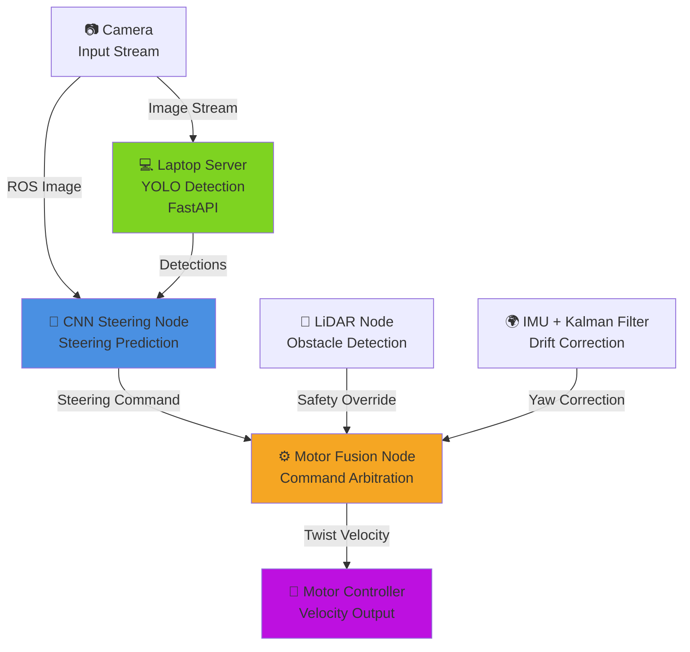
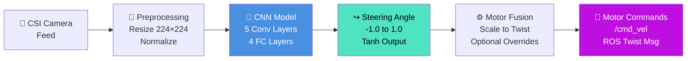
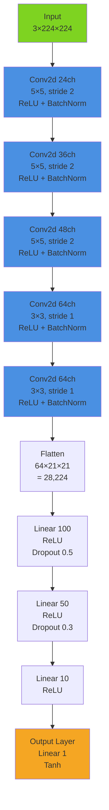
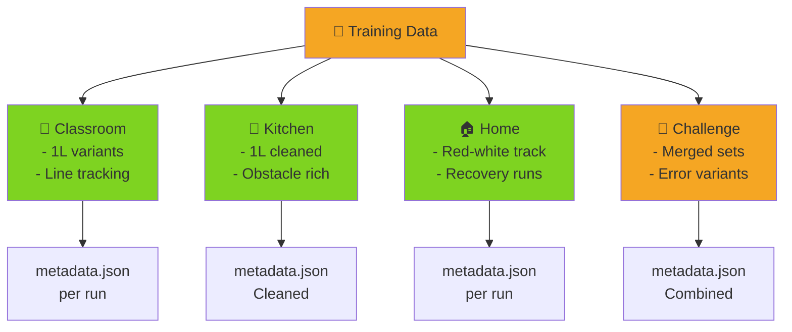
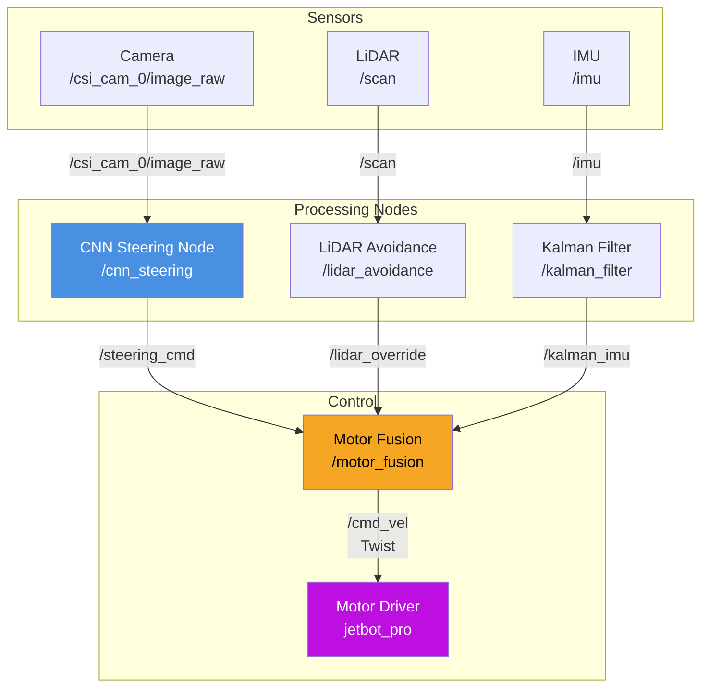

# JetBot BIP Project - Portfolio Overview

## Project Summary

An autonomous robotics project featuring a JetBot with vision-based steering control and real-time object detection. A CNN trained by behavioural cloning drives the robot from camera images, and a laptop-side YOLO server detects people and triggers an alarm on the robot. LiDAR obstacle avoidance and Kalman-filtered IMU drift correction are implemented as optional modules (not used in the final demo).

**Key Technologies:** ROS, PyTorch, YOLO, FastAPI, Kalman Filtering, Sensor Fusion

---

## System Architecture



### Component Breakdown

#### 1. **CNN Steering Node** (Core Navigation)
- **Input:** Camera images (224×224 RGB)
- **Output:** Steering angle (-1 to 1, normalized)
- **Architecture:** 5-layer CNN with batch normalization
- **Features:**
  - Lightweight and full model variants
  - Trained on several indoor environments (classroom, kitchen, home)
  - Inference loop at 10 Hz on the Jetson
  - Communicates with laptop YOLO server for person/bottle detection

#### 2. **Motor Fusion Node** (Control Logic)
- **Inputs:** Vision steering; optionally LiDAR override, IMU correction, speed multiplier
- **Output:** Robot velocity commands (Twist message)
- **Features:**
  - Holds the robot still until the CNN reports ready
  - Optional LiDAR obstacle avoidance override
  - Optional IMU-based drift correction
  - Speed scaling factor

#### 3. **Object Detection Server** (FastAPI)
- **Framework:** FastAPI + YOLOv8 Nano
- **Endpoint:** `POST /detect` - Analyzes images for persons and bottles
- **Features:**
  - Configurable confidence threshold (default 0.35)
  - Triggers alarm on person detection
  - Returns bounding boxes and confidence scores

#### 4. **Kalman Filter Node** (Optional Sensor Fusion)
- **Input:** Raw MPU9250 IMU data (accelerometer, gyroscope)
- **Output:** Filtered orientation quaternion on `/kalman_imu`
- **Purpose:** Removes sensor noise and drift for stable navigation

---

## Data Pipeline



---

## CNN Model Architecture



**Parameters:** ~2.96M trainable parameters (most in the first FC layer) | **Checkpoint size:** ~12 MB

---

## Training Data Organization



Each recording run stores images plus a `metadata.json` (steering, throttle, IMU ω, timestamp). Runs are cleaned and merged with the scripts in `scripts/`, and a separate model was trained per environment (1-line classroom, classroom, classroom line, kitchen, red-white home, and a merged RGB set). Datasets and weights are not included in the repository.

---

## ROS Communication Graph



---

## Key Features & Innovations

### 🤖 **Autonomous Steering**
- CNN trained by behavioural cloning on gamepad-driven runs
- Separate models trained for classroom, kitchen and home tracks
- New runs can be recorded, cleaned and merged into existing datasets

### 🛡️ **Optional Multi-Sensor Fusion**
- **Vision:** CNN steering prediction
- **LiDAR:** Obstacle detection and emergency override
- **IMU:** Kalman-filtered orientation for drift correction
- **Arbitration:** Safety-first decision making (LiDAR override prioritized)

### 🔍 **Real-Time Object Detection**
- YOLOv8 Nano for fast inference
- Person and bottle detection
- Alarm triggering on critical objects
- Configurable confidence thresholds

### 📊 **Scalable Architecture**
- Modular ROS nodes (independent, reusable)
- Dual model support (lightweight vs. high-accuracy)
- Multi-environment training pipeline
- Easy to add new datasets and sensors

---

## Implementation Highlights

### Performance Metrics
| Metric | Value |
|--------|-------|
| CNN Inference Rate | 10 Hz |
| Frames sent to YOLO server | 5 Hz |
| Motor Command Rate | 20 Hz |
| Checkpoint Size | ~12 MB |
| Trainable Parameters | ~2.96M |

### Tech Stack
- **Robotics:** ROS (Robot Operating System)
- **Deep Learning:** PyTorch, YOLO (YOLOv8)
- **Web Framework:** FastAPI, Uvicorn
- **Computer Vision:** OpenCV
- **Filtering:** Kalman Filter (custom MPU9250)
- **Hardware:** Jetson Nano, JetBot chassis

### Training Pipeline
- **Framework:** PyTorch
- **Loss / Optimizer:** MSE, Adam with ReduceLROnPlateau
- **Data Augmentation:** Flip/brightness/shadow augmentation implemented but disabled (`USE_AUGMENTATION`); with small datasets and short runs it hurt performance
- **Validation:** 20 % random hold-out split
- **Checkpointing:** Model checkpoints at epochs 10, 20, 30, 40, 50

---

## File Structure

```
jetbot_bip_project/
├── server.py                    # FastAPI YOLO detection server
├── alarm_server.py              # Alarm notification service
├── requirements-*.txt           # Dependencies (robot, server, training)
├── core/
│   ├── model.py                # CNN architecture definition
│   └── config.py               # Centralized configuration
├── nodes/                       # ROS nodes
│   ├── cnn_steering_node.py     # Main steering predictor
│   ├── motor_fusion_node.py     # Control arbitration
│   ├── data_collector_node.py   # Data collection
│   └── lidar_backup_avoidance_node.py
├── kf-mpu9250/                  # Kalman filter for IMU
├── launch/                      # ROS launch files
├── ressources/                  # Alarm sound
└── scripts/                     # Utilities (training, dataset cleanup, visualization)
```

---

## Setup & Deployment

### Quick Start
```bash
# On Jetson Nano (robot):
python3 alarm_server.py
roslaunch jetbot_project autonomous.launch

# On Laptop (detection server):
uvicorn server:app --host 0.0.0.0 --port 8000
```

### Configuration
- `LAPTOP_IP` / `JETSON_IP` (env or `core/config.py`): network addresses of the detection server and robot
- `JETSON_ALARM_URL` (env, laptop): alarm endpoint on the robot, defaults to `http://$JETSON_IP:9000/alarm`
- `ALARM_WAV`, `ALARM_COOLDOWN` (env, robot): alarm sound file (defaults to `ressources/alarm.wav`) and cooldown

### Model Selection
The steering node loads `models/checkpoints/best_model.pth`; `USE_LIGHTWEIGHT_MODEL` in `core/config.py` switches between the full and lightweight architectures.

---

## Future Improvements

- [ ] Reinforcement learning for policy optimization
- [ ] Sim2Real transfer learning (Gazebo simulation)
- [ ] Multi-robot fleet coordination
- [ ] Edge deployment optimization (ONNX/TensorRT)
- [ ] Real-time semantic segmentation
- [ ] Path planning with RRT*

---

## Conclusion

This project demonstrates a complete end-to-end autonomous robotics system combining deep learning, real-time control and distributed object detection, with optional sensor fusion. The modular architecture and multi-environment training approach showcase scalability and practical robotics engineering principles.

